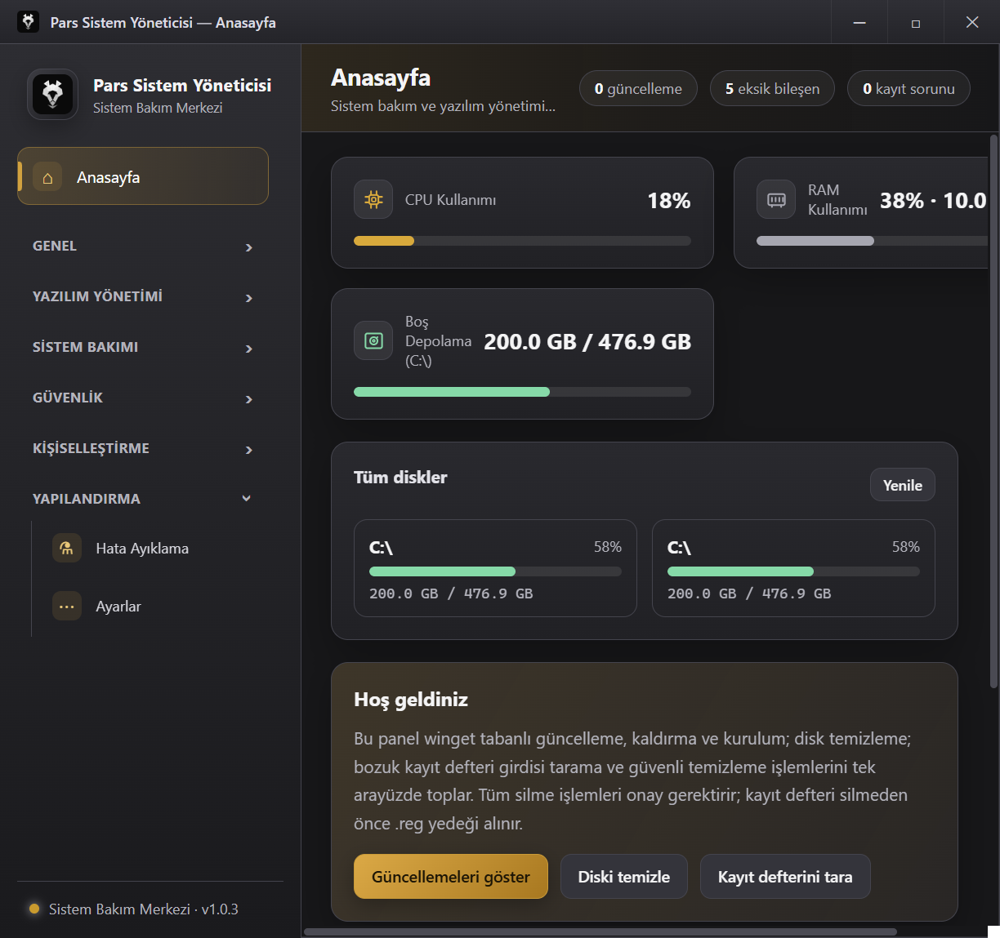
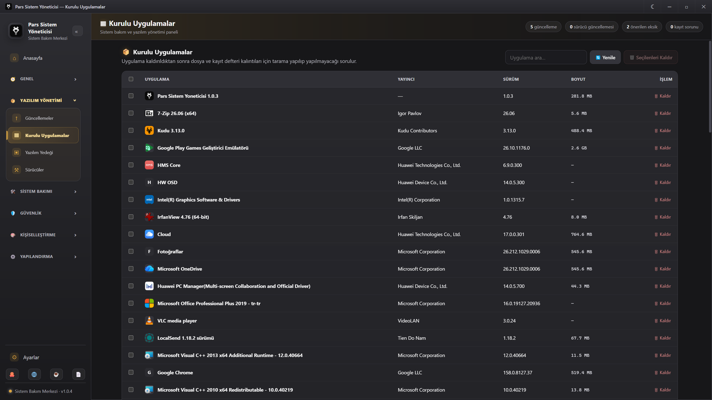
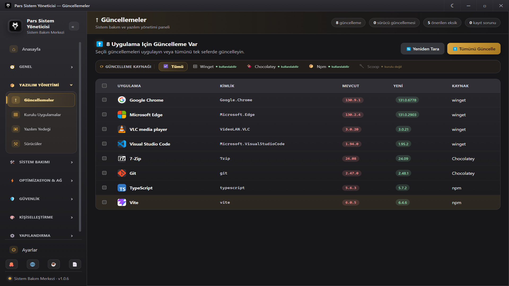
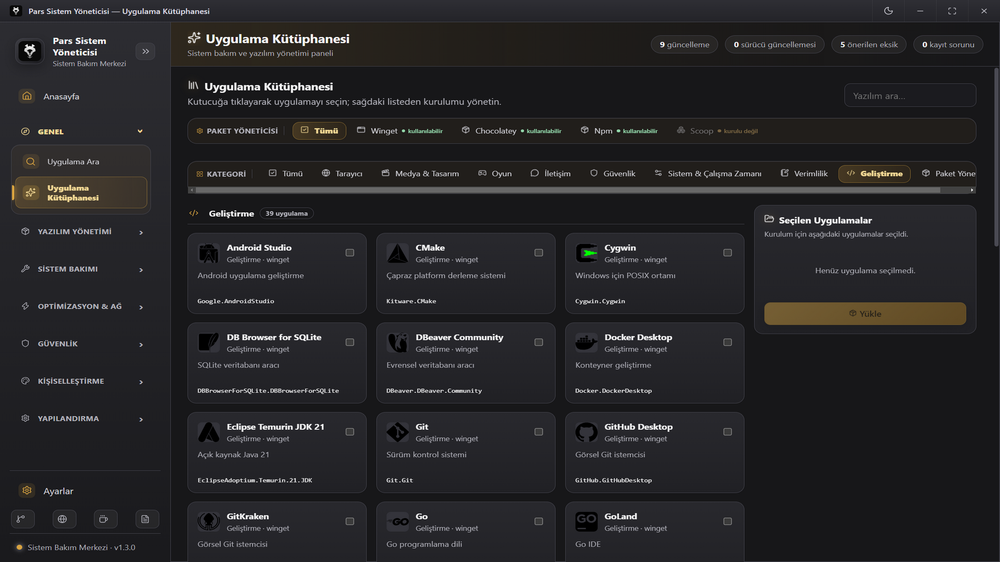
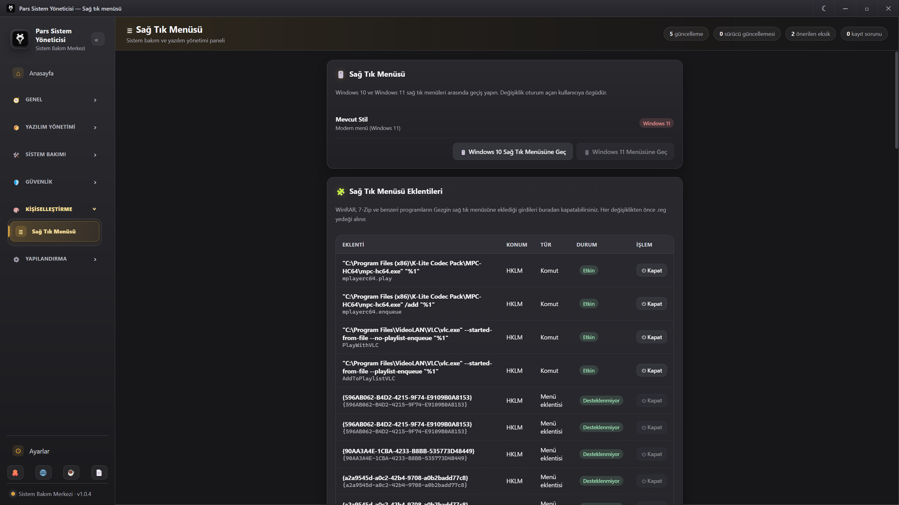

<a id="turkce"></a>

# 🇹🇷 Pars Sistem Yöneticisi (TypeScript / Electron)

Windows, macOS ve Linux için sistem bakım ve yazılım yöneticisi paneli. Windows’ta winget tabanlı
yazma özellikleri; macOS ve Linux’ta salt-okunur çekirdek. Mevcut Python uygulamasının
TypeScript + Electron + React karşılığıdır; eski `YazilimYoneticisi/` klasörüne dokunulmaz.

[](https://github.com/pars-sistem-yonetici/pars-sistem-yoneticisi/releases/latest)
[](https://github.com/pars-sistem-yonetici/pars-sistem-yoneticisi/releases)
[](LICENSE)
[](https://pars-sistem-yonetici.github.io/pars-sistem-yoneticisi/download.html)
[](https://pars-sistem-yonetici.github.io/pars-sistem-yoneticisi/download.html)
[](https://pars-sistem-yonetici.github.io/pars-sistem-yoneticisi/download.html)

**Dil / Language:** [🇹🇷 Türkçe](#turkce) · [🇬🇧 English](#english)

## 🆕 1.6.0 birleşik sürümü

- **Tek release, üç platform:** Windows kurulum/portable `.exe`, macOS `arm64`/`x64` `.dmg` + `.zip` ve Linux `x64` AppImage + `.deb` aynı [1.6.0 release’inde](https://github.com/pars-sistem-yonetici/pars-sistem-yoneticisi/releases/tag/1.6.0) toplandı. Bu release GitHub **Latest**’tir; `1.4.0` ve macOS `1.5.0` release’leri geçmiş olarak korunur.
- **İç sürüm notu:** Windows dosyaları `1.6.0`, macOS dosyaları `1.5.0`, Linux dosyaları `1.6.0` kaynak derlemeleridir. `1.6.0` birleşik dağıtım etiketidir.
- **Linux kapsamı:** apt, dnf, pacman, flatpak ve snap yalnızca arama/listeleme için salt-okunur kullanılır; yazma eylemleri ve self-update kapalıdır.
- **Doğrulama:** `SHA256SUMS-1.6.0.txt` (Windows + macOS), `SHA256SUMS-Linux.txt` (Linux) ve tüm dosyaların ayrıntılı listesi `INDIRME_LINKLERI.md` asset’lerinde yayımlandı.

| Platform | Dosyalar | SHA-256 (özet) |
| --- | --- | --- |
| Windows | `Pars.Sistem.Yoneticisi.Setup.1.6.0.exe` | `1b0256aa324e2d93940d83788fa03f46f41be2663c7583825be0f14766258a90` |
| Windows | `ParsSistemYoneticisi-Portable.exe` | `2952b083d4960e8d666538051c00932ae572e4d55d6e2bbe7f555299af48a560` |
| macOS arm64 | `.dmg` / `.zip` | `0f1bb0a9…` / `22af969d…` |
| macOS x64 | `.dmg` / `.zip` | `027cd67d…` / `4b0421d4…` |
| Linux x64 | `.AppImage` | `f0ddffe55e88b353186beeb3cffa49061955faa26990a798f2972b1fef6bc143` |
| Linux x64 | `.deb` | `354f83b5e824d01b77a521aad4ae78309d4be8e4a4360a64bf86a74a60aaaffb` |

Arayüz, grafit/gümüş palet ve koyu sarı vurgularla temalandırılmıştır. **Ayarlar → Tema** üzerinden
Windows 11 açık temasına anında geçilebilir; tercih `settings.json` içinde saklanır. Windows'un native
başlık çubuğu yerine temayla uyumlu, sürüklenebilir özel pencere çerçevesi kullanılır;
küçültme/büyütme/kapatma düğmeleri de aynı paleti izler. Anasayfadaki CPU/RAM/boş depolama kartlarında
durum ikonları bulunur. Aynı anda yalnızca bir uygulama örneği çalışır; ikinci başlatma mevcut pencereyi
geri yükleyip öne getirir. Sistem tepsisindeki simge ve “Pencereyi göster” kısayolu da küçültülmüş veya
gizlenmiş pencereyi açar.

## 🆕 1.3.0 yenilikleri

- **Uygulama ikonları tamamlandı:** 249 uygulamanın 35 mevcut ikonu denetlendi; 127 uygulamaya yeni ikon eklendi, 7 bozuk favicon düzeltildi. Kütüphane kartlarında eksik veya hatalı logo kalmadı.
- **Doğrulanmış ikon kaynakları:** 155 uygulama Simple Icons vektör logosu (`16.38.1` sabit sürüm), 6 uygulama doğrulanmış doğrudan URL, 1 uygulama yerel SVG kullanıyor. Toplam 162 açık ikon ve 87 çalışan favicon yedeği var; tüm adresler HTTP 200 doğrulandı.
- **Kapsamlı tarama:** Geçersiz marka slug’ı 0, bozuk doğrudan ikon 0, bozuk favicon 0. PotPlayer’ın bağlantı sıfırlayan favicon adresi çalışan bir servisle değiştirildi.
- **Yenilenen ekran görüntüleri:** Tanıtım sitesi, README, Wiki ve GitHub Releases aynı 1.3.0 görsellerini kullanıyor; kütüphane ekranı yenilenen ikonları gösteriyor.
- **1.2.0 ve öncesi korundu:** Vektör arayüz ikonları, 249 uygulamalık katalog, winget eksikse resmi Microsoft kaynağından otomatik kurulum, alt bilgi dağıtımı ve çok kaynaklı salt-okunur tarama sürüyor.
- **Güvenlik modeli değişmedi:** Yönetici izni, açık onay, zorunlu yedek, salt-okunur tarama varsayılanı, `deleteAppDataOnUninstall: false` ve korumalı kayıt kuralları aynı.

Ayrıntılar için [RELEASE_NOTES.md](RELEASE_NOTES.md) dosyasına bakın.

## 🆕 1.1.0 yenilikleri

- **Kurucuya winget kurulumu:** NSIS kurulumu `winget.exe` denetler; eksikse gömülü `install-winget.ps1` betiğiyle Microsoft.WinGet.Client üzerinden resmi kaynaktan sessizce kurar ve doğrular. `/S --updated` ile yapılan sessiz güncellemelerde de aynı akış çalışır; ek onay penceresi çıkmaz.
- **Hata toleransı:** winget kurulamazsa uygulama kurulumu tamamlanır, NSIS günlüğüne uyarı yazılır ve “Gerekli bileşenler” panelinden yeniden denenebilir. Betik tekrar çalıştırıldığında winget varsa doğrudan `OK` döner.
- **Site metinleri:** İndirme sayfası ve ana sayfa, kurucunun otomatik winget kurulumunu ve portable sürümdeki elle kurulum seçeneğini açıklıyor.
- **1.0.9 ve önceki düzeltmeler korundu:** Alt bilgi dağıtımı, kütüphane kategori başlıkları, doğru NSIS anahtarları, eski istemci uyumu ve salt-okunur tarama sürüyor.
- **Güvenlik modeli korundu:** Yönetici izni, açık onay, zorunlu yedek, salt-okunur tarama ve `deleteAppDataOnUninstall: false` değişmedi.

Ayrıntılar için [RELEASE_NOTES.md](RELEASE_NOTES.md) dosyasına bakın.

## 🆕 1.0.9 yenilikleri

- **Alt bilgi dağıtıldı:** 1.0.8 exe’sinin içinde kalan `v1.0.7` yazısı düzeltildi. Sürüm arttığı için 1.0.7 ve 1.0.8 kullanıcıları self-updater ile güncelleme onayı alıyor; indirme SHA-512 ile doğrulanıyor.
- **Site ve Blogger metinleri:** İndirme sayfası ve Blogger çıktısındaki eski `1.0.7` metin/URL’leri temizlendi; indirme düğmeleri doğrudan GitHub Releases adreslerini kullanıyor.
- **Yayın üretimi:** `ci-release.js` site dosyalarındaki sürüm belirteçlerini artık manifestteki eski sürüme bakmadan güncelliyor. 1.0.9, kaynaklar `main`’e eşitlendikten sonra tek kaynaktan üretildi; etiket/dosya yarışı kaldırıldı.
- **1.0.8 ve 1.0.7 düzeltmeleri korundu:** Kütüphane kategori başlıkları, doğru NSIS anahtarları, eski istemci uyumu, hata bildirimi ve disk alanı kontrolü sürüyor.
- **Güvenlik modeli korundu:** Yönetici izni, açık onay, zorunlu yedek, salt-okunur tarama ve `deleteAppDataOnUninstall: false` değişmedi.

Ayrıntılar için [RELEASE_NOTES.md](RELEASE_NOTES.md) dosyasına bakın.

## 🆕 1.0.8 yenilikleri

- **Kategori başlıkları:** Uygulama Kütüphanesi’ndeki kartlar üstteki kategori sekmeleriyle aynı sıralamada gruplanıyor. Her grubun üstünde o sekmenin ikonu, kategori adı ve içerdiği uygulama sayısı gösteriliyor; arama ve paket yöneticisi filtresi uygulandığında başlıklar ve sayılar güncelleniyor.
- **Kaynak etiketi:** Paket yöneticisi sekmelerinden biri seçildiğinde grup başlıklarında hangi kaynağın görüntülendiği (winget, Chocolatey, npm, Scoop) ayrıca belirtiliyor; “Tümü” seçiliyken etiket gizleniyor.
- **1.0.7 düzeltmeleri korundu:** Doğru NSIS anahtarları (`/S --updated`), eski istemciler için `/SILENT` uyumluluğu, kurulum hata bildirimi ve disk alanı kontrolü sürüyor.
- **Güvenlik modeli korundu:** Yönetici izni, açık onay, zorunlu yedek, salt-okunur tarama ve `deleteAppDataOnUninstall: false` değişmedi.

Ayrıntılar için [RELEASE_NOTES.md](RELEASE_NOTES.md) dosyasına bakın.

## 🆕 1.0.7 yenilikleri

- **Doğru sessiz güncelleme:** Uygulama güncelleyicisi NSIS kurucusunu artık `/S` ve `--updated` anahtarlarıyla başlatıyor. Eski `/SILENT` ve `/CLOSEAPPLICATIONS` anahtarları bu kurucu tarafından tanınmadığı için güncelleme “uygulama çalışıyor” penceresinde takılıyordu; `--updated` ile kurulum güncelleme olarak algılanıyor, kısayollar korunuyor.
- **Eski sürüm uyumu:** Kurucuya `preInit` aşamasında `/SILENT` tanıma eklendi. 1.0.4, 1.0.5 ve 1.0.6 kullanıcıları bu sürümü indirdiğinde eski argümanlarla da olsa sessiz kurulum yapılabiliyor.
- **Anlaşılır hatalar:** Kurulum başlatılamazsa artık hata mesajı gösteriliyor; sessizce “başarılı” denip kapanmıyor. İndirmeden önce disk alanı kontrolü yapılıyor; disk doluysa veya bağlantı koparsa Türkçe uyarı veriliyor.
- **Güvenlik modeli korundu:** Yönetici izni, açık onay, zorunlu yedek, salt-okunur tarama ve `deleteAppDataOnUninstall: false` değişmedi.

Ayrıntılar için [RELEASE_NOTES.md](RELEASE_NOTES.md) dosyasına bakın.

## 🆕 1.0.6 yenilikleri

- **Dock filtreleri:** Uygulama Kütüphanesi’ndeki kategori ve paket yöneticisi satırları, sol gezinmeyle aynı dock görünümünde iki yatay seçiciye dönüştürüldü. Aktif seçim, ikonlar, kullanılabilirlik durumu ve klavye/erişilebilirlik özellikleri korundu.
- **Çok kaynaklı güncellemeler:** Güncellemeler sekmesinde `Tümü / winget / Chocolatey / npm / Scoop` seçicisi eklendi. Taramalar salt okunurdur; başarısız kaynak diğerlerini etkilemez. Sahte winget uyarı satırı filtrelendi.
- **Kaynak güvenliği:** Her kaynak için ayrı kimlik doğrulama kalıbı uygulanır; güncellemeler kendi paket yöneticisiyle uygulanır. Kurulum yine manuel onaylıdır, varsayılan salt-okunur davranış değişmedi.

Ayrıntılar için [RELEASE_NOTES.md](RELEASE_NOTES.md) dosyasına bakın.

## 🆕 1.0.5 yenilikleri

- **Sistem Ayarları:** 63 tersine çevrilebilir Windows & ağ ayarı; Ağ & Gecikme 11, Sistem & Performans 14, Arayüz & Deneyim 17, Gizlilik & Telemetri 11, Servis Yönetimi 10. Hiçbiri otomatik uygulanmaz; her değişiklikte zorunlu `.reg` + JSON yedeği alınır.
- **Optimizasyon Profilleri:** Rekabetçi Oyuncu, Düşük Gecikme Ağ, Dengeli Optimizasyon ve Güvenli Gizlilik. Profiller açık onayla uygulanır/geri alınır; başarısız ayarlar raporlanır.
- **DNS Karşılaştırma:** Cloudflare, Google, Quad9, AdGuard ve OpenDNS gecikmeleri ölçülür; en hızlı sağlayıcı tek tıkla uygulanır, DHCP sıfırlama ve zorunlu yedek vardır. Ölçüm salt okunurdur.
- **Gelişmiş Onarımlar:** NIC düşük gecikme ayarları (+ geri yükleme), Prefetch temizliği, performans sayaçları/WMI rebuild, Installer 2502/2503 `icacls` yetki onarımı, `w32tm` NTP senkronizasyonu ve `bcdedit` Güvenli Mod aç/kapat + durum sorgulama.
- Sol gezinmede yeni **Optimizasyon & Ağ** grubu; kategori filtresi, ayar arama ve sonuç kartları eklendi.

Ayrıntılar için [RELEASE_NOTES.md](RELEASE_NOTES.md) dosyasına bakın.

## 🖼️ Ekran görüntüleri (1.3.0)

Aşağıdaki görüntüler 1.3.0 arayüzünden alınmıştır: yenilenen uygulama ikonları, vektör arayüz
ikonları ve genişletilmiş Uygulama Kütüphanesi dahil tüm ekranlar yenilendi. Tanıtım sitesi, Wiki
ve GitHub Releases sayfası aynı dosyaları kullanır.

| Anasayfa | Kurulu Uygulamalar |
| --- | --- |
|  |  |
|  |  |
|  | |

## ⬇️ Hızlı kurulum

- **Son sürüm (1.6.0, birleşik):** [GitHub Releases](https://github.com/pars-sistem-yonetici/pars-sistem-yoneticisi/releases/tag/1.6.0)
- **Windows:** [`Pars.Sistem.Yoneticisi.Setup.1.6.0.exe`](https://github.com/pars-sistem-yonetici/pars-sistem-yoneticisi/releases/download/1.6.0/Pars.Sistem.Yoneticisi.Setup.1.6.0.exe) · [`ParsSistemYoneticisi-Portable.exe`](https://github.com/pars-sistem-yonetici/pars-sistem-yoneticisi/releases/download/1.6.0/ParsSistemYoneticisi-Portable.exe)
- **macOS:** [`arm64.dmg`](https://github.com/pars-sistem-yonetici/pars-sistem-yoneticisi/releases/download/1.6.0/Pars.Sistem.Yoneticisi-1.6.0-arm64.dmg) · [`arm64.zip`](https://github.com/pars-sistem-yonetici/pars-sistem-yoneticisi/releases/download/1.6.0/Pars.Sistem.Yoneticisi-1.6.0-arm64.zip) · [`x64.dmg`](https://github.com/pars-sistem-yonetici/pars-sistem-yoneticisi/releases/download/1.6.0/Pars.Sistem.Yoneticisi-1.6.0-x64.dmg) · [`x64.zip`](https://github.com/pars-sistem-yonetici/pars-sistem-yoneticisi/releases/download/1.6.0/Pars.Sistem.Yoneticisi-1.6.0-x64.zip)
- **Linux:** [`x64.AppImage`](https://github.com/pars-sistem-yonetici/pars-sistem-yoneticisi/releases/download/1.6.0/Pars.Sistem.Yoneticisi-1.6.0-x64.AppImage) · [`x64.deb`](https://github.com/pars-sistem-yonetici/pars-sistem-yoneticisi/releases/download/1.6.0/Pars.Sistem.Yoneticisi-1.6.0-x64.deb)
- **Doğrulama:** [İndirme sayfasındaki SHA-256 özetleri](https://pars-sistem-yonetici.github.io/pars-sistem-yoneticisi/download.html) · [`SHA256SUMS-1.6.0.txt`](https://github.com/pars-sistem-yonetici/pars-sistem-yoneticisi/releases/download/1.6.0/SHA256SUMS-1.6.0.txt) · [`SHA256SUMS-Linux.txt`](https://github.com/pars-sistem-yonetici/pars-sistem-yoneticisi/releases/download/1.6.0/SHA256SUMS-Linux.txt)

winget kataloğuna alındığında tek satır kurulum:

```powershell
winget install --id ParsSistemYonetici.ParsSistemYoneticisi --exact
```

Kurulum UAC onayı ister; `winget.exe` eksikse kurucu Microsoft.WinGet.Client üzerinden resmi kaynaktan sessizce kurar. Manifest taslağı `winget/` klasöründedir.

## 📦 Hazır çıktılar

1.6.0 release’inde 11 dosya yayımlandı:

- **Windows (2):** `Pars.Sistem.Yoneticisi.Setup.1.6.0.exe`, `ParsSistemYoneticisi-Portable.exe`
- **macOS (4):** arm64 ve x64 için `.dmg` + `.zip`
- **Linux (2):** `Pars.Sistem.Yoneticisi-1.6.0-x64.AppImage`, `Pars.Sistem.Yoneticisi-1.6.0-x64.deb`
- **Doğrulama/belge (3):** `SHA256SUMS-1.6.0.txt`, `SHA256SUMS-Linux.txt`, `INDIRME_LINKLERI.md`

Yerel `release/` klasöründeki exe’ler önizleme derlemeleridir; yayınlanan asset’lerle aynı özete sahip
değildir. Yayınlanan dosyaların adları ve özetleri yukarıdaki release bağlantılarındadır. `win-unpacked/`
derleme sırasında oluşan geçici klasördür; dağıtıma dahil edilmez. Yerel kopyalar
`YazilimYoneticisiTS\release\` ve `GitHubYukleme\02_GITHUB_RELEASE_EXELERI\` klasörlerinde tutulur;
depoya eklenmez.

## 🌐 Tanıtım ve indirme sitesi

`website/` klasöründe uygulamanın grafit/altın paletini kullanan bağımsız bir statik site vardır:

- `index.html` — tanıtım, özellikler, güvenlik yaklaşımı ve sık sorulan sorular
- `download.html` — Windows kurulum/portable, macOS DMG/ZIP ve Linux AppImage/DEB kartları; SHA-256 doğrulama ve kurulum adımları
- `downloads/latest.json` — son sürüm bildirimi (Windows alanlarına ek olarak Linux AppImage/DEB ad, özet, boyut ve URL)
- `blogger.html` — Blogger için CSS/JS/ikon gömülü tek dosyalık sürüm (`npm run build:blogger`)

Yerel görüntülemek için `website/index.html` dosyasını tarayıcıda açın. Yayınlanan site `docs/`
klasöründen GitHub Pages üzerinde durur; `docs/` ve `website/` dosyaları bayt bayt aynı tutulur.
Windows/macOS üretimi `.github/workflows/release.yml`, Linux AppImage/DEB üretimi
`.github/workflows/release-linux.yml` ile manuel olarak başlatılır. Ayrıntılar
`GitHubYukleme\05_ACTIONS_REHBER.md` dosyasındadır. Kullanım kılavuzu ve sık sorulan
sorular [GitHub Wiki](https://github.com/pars-sistem-yonetici/pars-sistem-yoneticisi/wiki) sayfasındadır.

## 🧩 Özellikler

| Sekme | Yapılan iş |
| --- | --- |
| **Anasayfa** | CPU, RAM ve seçili sürücüde boş alan kartları (15 sn’de bir yenilenir) ve sistem özeti. Disk kartlarında birim adı (ör. `Windows`, `Yerel Disk`) gösterilir; bilgiler okunurken animasyonlu “Disk bilgileri alınıyor…” durumu görünür. |
| **Güncellemeler** | `Tümü / winget / Chocolatey / npm / Scoop` kaynak seçicisiyle güncelleme tarar; seçilenleri veya tümünü kendi paket yöneticisiyle günceller. Taramalar salt okunurdur, başarısız kaynaklar diğerlerini engellemez. Tabloda kurulu uygulama/katalog ikonu, okunabilir kaynak adı ve mevcut sürüm gösterilir. winget’in saptanamayan sürüm uyarısı sahte satır olarak eklenmez. |
| **Kurulu Uygulamalar** | Kayıt defterinden gerçek ikonlarla uygulamaları listeler; arama, seçim, winget ile kaldırma ve kaldırma sonrası kalıntı taraması. Kaldırma bitince liste birkaç kez yenilenip kaldırılan uygulama kaybolana kadar bekler; güncelleme listesi de otomatik tazelenir. Toplu kaldırmada tarama yalnızca tüm kaldırma işlemleri bittikten sonra başlar; başarısız kaldırmalar taranmaz. Kalıntılar Geri Dönüşüm Kutusu’na taşınabilir veya açık onayla kalıcı silinebilir. |
| **Yazılım Yedeği** | `winget export` ile kurulu paket listesini JSON olarak yedekler; yeni kurulumdan sonra yedek dosyasını inceleyip yalnızca seçtiğiniz paketleri `winget import` ile geri yükler. Yedekler uygulama veri klasöründe tutulur, dosya yolu dışarıdan okunamaz. Program verileri yedeklenmez. |
| **Başlangıç** | Windows ile açılan uygulamaları (HKCU/HKLM `Run`, `RunOnce` ve Başlangıç klasörleri) listeler; tek tıkla kapatıp açar. Devre dışı bırakılan kayıt girdileri yedeklenir, kısayollar `.disabled` olarak yeniden adlandırılır; geri açma anında geçerlidir. |
| **Güvenlik Duvarı** | Etkin gelen kuralları denetler; kapsamı geniş (`Any`/`0.0.0.0/0`), programı belirtilmemiş, dosya yolu eksik veya imzasız/bozuk imzalı ikilileri **KRİTİK**, tek başına sorunlu olanları **ORTA** olarak işaretler. Seçilen kural tek tıkla devre dışı bırakılabilir veya silinebilir; silmeden önce kural + filtreler JSON olarak yedeklenir (yedek alınamazsa silinmez). |
| **Kötü Amaçlı Yazılım** | Sekiz yerel, salt-okunur motor: imzalar, sezgisel analiz, betikler, sistem bütünlüğü, kalıcılık izleri, Defender durumu, HOSTS dosyası ve tarayıcı eklentileri/ilkeleri. Her motor ayrı ayrı açılıp kapatılabilir; tarama gerçek incelenen nesne sayısını (`scanned`) bildirir, bulgular aranabilir/filtrelenebilir ve metin veya JSON olarak dışa aktarılabilir. Dosya silmez, işlem sonlandırmaz, kayıt yazmaz ve antivirüs yerine geçmez. |
| **Disk Temizleme** | Geçici dosyalar, küçük resim önbelleği, Windows Update indirmeleri, hata raporları, internet önbelleği, Delivery Optimization, yalnızca cache alt klasörleri (Edge/Chrome/Firefox), npm/NuGet/pip önbellekleri, DNS ve Geri Dönüşüm Kutusu kategorilerini tarar; seçilenleri onay sonrası temizler. Her temizleme `%LOCALAPPDATA%\ParsSistemYoneticisi\logs\disk-cleanup.jsonl` dosyasına kalıcı olarak kaydedilir ve "Temizlik kaydını aç" düğmesiyle görüntülenebilir. |
| **Dosya Tarayıcı** | Seçtiğiniz köklerde yinelenen dosyaları SHA-256 ile doğrulayıp gruplar, 20 MB üzeri dosyaları ve boş dosya/klasörleri listeler. Referans olarak eklediğiniz klasörler taramada görünür ama asla silinmez; sembolik bağlantılar, korumalı sistem yolları ve hariç tutulanlar atlanır. Silme varsayılan olarak Geri Dönüşüm Kutusu’na yapılır, kalıcı silme açık onay ister. |
| **Disk Analizi** | Bir sürücü/klasörün toplam boyutunu, klasör ağacını, uzantı dağılımını ve en büyük dosyaları tek geçişte çıkarır; treemap üzerinden klasörleri açar. Tamamen salt okunurdur, hiçbir şey silmez. |
| **Sistem Onarımı** | `sfc /scannow`, `DISM /RestoreHealth` ve geri yükleme noktasının yanında salt okunur tanılama (`/CheckHealth`, `/ScanHealth`, `/AnalyzeComponentStore`, `sfc /verifyonly`, `chkdsk /scan`), Windows Update ve ağ yığını sıfırlama, bileşen deposu/Store/Search/yazıcı kuyruğu bakımı, tek tıkla sıralı onarım ve WinRE komut rehberi sunar. Değişiklik yapan işlemlerde onay ve zorunlu yedek vardır; yedek başarısızsa değişiklik yapılmaz. WinRE öncesi BCD yedeği alınabilir. |
| **Sürücüler** | Win32_PnPSignedDriver ile kurulu sürücüleri listeler; Windows Update Agent COM API ile sürücü güncellemelerini tarar, indirir ve kurar. Kurulum öncesi `dism /export-driver` ile yedek alma seçeneği vardır. Yönetici izni gerektiren işlemler açıkça bildirilir. |
| **Uygulama Kütüphanesi** | 9 kategoride winget, Chocolatey, npm ve Scoop uygulamaları. Kategori ve paket yöneticisi filtreleri dock görünümünde yatay seçicilerdir; kurulu olmayan yöneticiler devre dışıdır. Kartlar kategori sırasına göre sıralanır; kart tıklamasıyla seçim, sağ panelde seçili liste ve **Yükle** düğmesi. |
| **Kayıt Defteri** | Dokuz kapsamda **salt okunur** tarama: `Uninstall` (yinelenen/boş ad, eksik simge-kurulum klasörü, Temp altındaki kaldırıcı), `App Paths`, COM/`InprocServer32`/`LocalServer32`, HKCU CLSID geçersiz kılma şüphesi (imza kontrolü), dosya ilişkilendirmeleri, hizmet/sürücü `ImagePath`, `SharedDLLs`, yazı tipleri ve ODBC. Kapsamlar ayrı seçilir; tabloda kategori, risk ve öneri sütunları ile `Tümü / Bozuk / Güvenlik uyarısı / Sistem kritik` filtreleri vardır. `UserChoice`, COM, servis, SharedDLLs, font ve ODBC kayıtları **asla otomatik değiştirilmez**. Yalnızca kanıtlanmış bozuk `Uninstall`/`App Paths` girdileri `fixable` işaretlenir; bunlar için zorunlu `.reg` yedek + açık onay gerekir, yedek alınamazsa silinmez. Sistem/korumalı girdilerde onay penceresinde ek uyarı gösterilir. Tarama sonucu JSON veya CSV olarak dışa aktarılabilir; rapor yedeğin yerine geçmez. |
| **Zamanlama** | Haftalık tam temizlik, günlük hafif temizlik, aylık derin temizlik ve özel aralık olmak üzere dört devre dışı hazır plan. Saat/gün/aralık düzenlenebilir, planlar açıkça "Şimdi çalıştır" ile test edilebilir. Çalışma uygulama açıkken 60 saniyelik zamanlayıcı ile yapılır; Geri Dönüşüm Kutusu hiçbir plana dahil edilmez. |
| **Uygulama Ara** | winget kataloğunda arama, indirme (`winget download`) ve kurulum. |
| **Gelişmiş Başlangıç** | Zamanlı görevler, servisler, Winlogon/AppInit/IFEO kayıt değerleri ve WMI aboneliklerini Autoruns benzeri biçimde listeler; filtreler, yüksek yetkili girdi uyarısı, önizlemeli aç/kapat ve yedek zorunluluğu vardır. Winlogon ve WMI girdileri sistem açılışı için kritik olduğundan otomatik değiştirilmez. |
| **Gizlilik Ayarları** | Telemetri, reklam kimliği, arama önerileri, Widgets/haber akışı, dosya uzantıları ve gizli dosyalar gibi iyi bilinen Windows ayarlarını önizlemeli uygular. Her değişiklikten önce `.reg` yedeği alınır, özgün değer saklanır ve ayar tek tek geri alınabilir. |
| **Sağ tık menüsü** | Windows 10 klasik menüsü ile Windows 11 modern menüsü arasında geçiş yapar. Gizli `cmd` ile ilgili `HKCU\Software\Classes\CLSID\{86ca1aa0-…}` anahtarını ekler/siler, işlem bitince Windows Gezgini’ni otomatik yeniden başlatır. Değişiklik yalnızca oturum açan kullanıcıyı etkiler. **Yapılandırma** grubundadır. |
| **Hata Ayıklama** | "Kuruluşunuz tarafından yönetiliyor" bildirimini düzelten iki `.reg` dosyası: Windows ilkeleri ve tarayıcı (Chrome/Edge/Firefox/Brave/Opera/Vivaldi/Yandex) ilkeleri. İçerik arayüzde gösterilir, dosya olarak kaydedilebilir veya doğrudan uygulanabilir. Uygulama öncesi mevcut anahtarların 64/32-bit `.reg` yedekleri alınır; yedek başarısız olursa hiçbir anahtar silinmez. |
| **Ayarlar** | Arayüz dili (Türkçe, İngilizce ve Electron dil paketlerindeki **55 dil**; anında uygulanır), tema (varsayılan grafit/altın veya Windows 11 açık), **Windows ile başlat** ve **sistem tepsisinde başlat** anahtarları, **Hariç Tutulanlar** (klasör ve `.uzantı` listesi; tarama/temizleme/silme işlemleri bunlara dokunmaz), **Gerekli bileşenler** (winget / Chocolatey / npm / Scoop / PowerShell / Visual C++ taraması, eksikler için açık onaylı kurulum; kurumsal sessiz mod açıldığında eksik paket yöneticileri açılışta penceresiz ve onaysız kurulur), **Uygulama güncelleyici** (kendi sürümünü kontrol eder, SHA-512 doğrulamalı indirir ve onayla kurar), kayıt defteri `.reg` ve güvenlik duvarı JSON yedek klasörleri ("klasörü aç" düğmeleriyle), son işlemler listesi, winget durumu/sürümü (yalnızca burada), kaynak güncelleme, sessiz kurulum, kaldırma sonrası otomatik kalıntı taraması ve sürücü seçimi. **Destek ve bağlantılar** kartında Buy me a coffee, GitHub deposu, web sitesi ve MIT lisansı/telif hakkı bağlantıları vardır; aynı bağlantılar sol alt köşede de bulunur. **Kapatma davranışı** seçeneği "Her zaman sor" (varsayılan), "Sistem tepsisine küçült" veya "Uygulamayı kapat" olabilir; kapatırken "Bu tercihi hatırla" işaretlenirse seçim kalıcı hale gelir ve bu listeden değiştirilebilir. Alt+F4 de aynı akışı izler. Tepsiye küçültme sonrası programdan çıkmak için tepsi menüsündeki **Çıkış** kullanılır. |

Sol menüdeki sekmeler **Genel**, **Yazılım Yönetimi**, **Sistem Bakımı**, **Güvenlik**, **Kişiselleştirme** ve **Yapılandırma** gruplarında toplanır. Grup başlıklarında simge ve ok vardır; tıklanınca ilgili sekmeler dock görünümlü bir panelde aşağı doğru animasyonla açılır, aynı anda yalnızca bir grup açık kalır ve etkin sekmenin grubu açılışta otomatik genişler. Brand alanındaki düğme paneli tamamen daraltıp genişletir; daraltılmış halde simgeler görünür kalır. Ayarlar sol alt köşeye sabitlenmiştir. **Yapılandırma** grubu: **Sağ tık menüsü**, **Hata Ayıklama** ve **Ayarlar**.

Türkçe ve İngilizce tam çevirilidir. Diğer diller Electron/Chromium dil paketlerinden listelenir; arayüz
metinleri eksik çeviri dosyalarında İngilizceye döner. Kendi çevirinizi eklemek için Ayarlar’daki
**Çeviri klasörünü aç** düğmesini kullanıp `%APPDATA%\pars-sistem-yoneticisi-ts\translations\<dil-kodu>.json`
dosyasına Türkçe kaynak metin → çeviri anahtarlarını yazabilirsiniz.

## 🛠️ Geliştirme

```powershell
npm install
npm run dev       # Vite + Electron geliştirme modu
npm run build     # TypeScript + Vite derlemesi
npm run dist      # release/ içine NSIS + portable exe üretir
npm run dist:linux # release/ içine AppImage + .deb üretir (Linux runner önerilir)
npm run publish   # publish/updates içine latest.json + setup exe hazırlar
```

Node.js 20+ gerekir. Windows 10 (1809+) / Windows 11 ve güncel App Installer (winget) önerilir.
Linux paketleri `ubuntu-latest` runner üzerinde `.github/workflows/release-linux.yml` ile üretilir.

## 🔄 Uygulama güncellemesi

Uygulama, winget ile diğer yazılımları güncellemekten ayrı olarak **kendi sürümünü** de kontrol edebilir.
Açılışta kontrol varsayılan olarak açıktır; yeni sürüm bulunursa onay penceresi gösterilir. İndirme
öncesi bildirimdeki SHA-512 özeti doğrulanır, özet uyuşmazsa dosya silinir. İndirmeden önce hedef
sürücüde yeterli boş alan denetlenir; disk doluysa veya bağlantı koparsa anlaşılır hata mesajı gösterilir.
Kurulumdan önce ikinci bir onay alınır ve NSIS kurucusu `/S --updated` anahtarlarıyla sessiz modda
başlatılır. Kurulum başlatılamazsa uygulama “başarılı” demeden hatayı bildirir. 1.0.4–1.0.6 sürümlerinden
gelen istemciler de yeni kurucuyu `/SILENT` ile çağırsa bile `preInit` uyumluluğu sayesinde sessizce kurulur.
Portable sürümde exe değiştirilemediği için indirilenler klasörü açılır ve dosyayı elle kopyalama yönergesi gösterilir.
**macOS ve Linux’ta self-update kapalıdır**; yeni sürümü indirme sayfasından elle alın.

Varsayılan kaynak, projenin Pages adresindeki `downloads/latest.json` dosyasıdır
(`https://pars-sistem-yonetici.github.io/pars-sistem-yoneticisi/downloads`). Pakete ayrıca
`build/updates/latest.json` örnek bildirimi eklenir; Ayarlar → **Güncelleme kaynağı** alanına bir
http(s) adresi veya yerel klasör yazılarak başka bir kaynak kullanılabilir.
Bildirim biçimi:

```json
{
  "version": "1.4.0",
  "notes": "Yeni özellikler ve düzeltmeler",
  "fileName": "Pars Sistem Yoneticisi Setup 1.4.0.exe",
  "sha512": "<exe dosyasının base64 veya hex SHA-512 özeti>",
  "size": 83631421,
  "url": "Pars Sistem Yoneticisi Setup 1.4.0.exe"
}
```

`url` bildirim dosyasına göreli olabilir; verilmezse `fileName` kullanılır. Özeti üretmek için:

```powershell
certutil -hashfile ".\release\Pars Sistem Yoneticisi Setup 1.4.0.exe" SHA512
```

Bu adımları otomatik yapan `npm run publish` komutu da vardır. `package.json` sürümünü okur,
`release/` içindeki setup exe’yi bulur, SHA-512 ve boyutu hesaplar; exe’yi ve `latest.json` dosyasını
`publish/updates/` klasörüne kopyalar. Web’e yükleme yapmaz; klasörü siz yayınlarsınız.

```powershell
npm run publish
npm run publish -- --notes "Küçük düzeltmeler"
npm run publish -- --notes-file release-notes.txt
npm run publish -- --out C:\Yayin\updates
npm run publish -- --embed     # ayrıca build/updates/latest.json güncellenir
npm run publish -- --website   # website/downloads klasörünü de günceller
```

Web sitesini güncelleme kaynağı olarak kullanmak için `--website` ile yayınlayın ve uygulamada
**Güncelleme kaynağı** alanına sitenin `downloads` adresini yazın, örn.
`https://siteniz.com/downloads`. Site ayrıca `downloads/latest.json` dosyasını okuyup son sürümü ve
özetleri sayfada gösterir.

Türkçe sürüm notlarını komut satırında yazmak PowerShell’de karakter bozulmasına yol açabilir;
`--notes-file release-notes.txt` kullanın (dosya UTF-8 olmalı). `--out` ile ağ klasörünü veya web’e
yükleyeceğiniz klasörü doğrudan hedefleyebilirsiniz. `--embed`
yalnızca bir sonraki paketlemede gömülü manifest’i günceller; mevcut kurulu sürümlere ulaşmak için
güncelleme kaynağının sabit bir URL veya klasör olarak ayarlanması gerekir.

Yeni sürüm yayınlarken sürüm numarasını tek komutla güncelleyin (örnek: bir sonraki sürüm 1.4.0):

```powershell
npm run bump -- 1.4.0
```

Bu komut `package.json`, `package-lock.json` (ilk iki alan), `i18n.ts` başlığı, `README.md`,
`RELEASE_NOTES.md` ve `build/updates/latest.json` dosyalarındaki sürümü yazar. `website/` ve `docs/`
dosyalarına dokunmaz; onları workflow üretir. `RELEASE_NOTES.md` içeriğini gözden geçirdikten sonra
GitHub → Actions → **Sürüm yayınla** → **Run workflow** ile sürümü yazın. İndirilen kurulum dosyaları
`%APPDATA%\pars-sistem-yoneticisi-ts\updates` altında tutulur.

> `npm run publish` yalnızca el ile yayın yapıldığında gerekir; GitHub Actions akışı manifest’i
> kendisi üretir. `--check` ile `node scripts/bump-version.js 1.4.0 --check` değişiklikleri
> yazmadan görebilirsiniz.

## 🔐 Güvenlik

- Uygulama ve kurulum dosyası **`requireAdministrator`** manifest’i ile derlenir; Windows her açılışta
  UAC onayı ister. winget işlemleri, sürücü kurulumu, DISM yedeği ve yönetici gerektiren disk işlemleri
  yükseltilmiş oturumda çalışır.
- Disk temizlemede yalnızca tanımlı klasörlerin **içeriği** silinir; sembolik bağlantılar, korumalı kökler
  ve uygulamanın kendi klasörü **her özyineleme düzeyinde** yeniden denetlenir. Kilitli dosyalar atlanıp işlem devam eder.
  Tarama salt okunurdur; silme yalnızca açık onayla başlar ve sonuçlar JSONL denetim kaydına yazılır.
  Zamanlanmış temizlik yeni önbellek kategorilerini içermez.
- Kurumsal sessiz bileşen kurulumu varsayılan olarak kapalıdır. Açıldığında yalnızca eksik paket yöneticileri
  arka planda kurulur; Chocolatey ve Scoop resmi kurulum betikleriyle, npm Node.js LTS MSI'nin SHA-256 ve
  Authenticode doğrulamasıyla kurulur. Kurulumlar günlüğe yazılır; manuel kurulumda her zaman onay istenir.
- **Hariç Tutulanlar** ayarındaki klasörler ve uzantılar disk temizleme, kalıntı, malware, başlangıç ve
  güvenlik duvarı program yollarında tamamen atlanır. Klasör silinirken içindeki hariç tutulmuş öğeler
  korunur; bu yüzden üst klasörün tamamı atlanır.
- Kalıntı silmede varsayılan yöntem Geri Dönüşüm Kutusu’dur; kalıcı silme ayrı onay ister.
- Kayıt defteri silme işlemi yalnızca işaretli girdilerle sınırlıdır ve `reg export` yedeği zorunludur.
  Yedekler `%LOCALAPPDATA%\ParsSistemYoneticisi\registry_backups` altındadır.
- Güvenlik duvarı kural silme işlemi de yedek zorunluluğuna tabidir; kural ve port/uygulama filtreleri
  `%LOCALAPPDATA%\ParsSistemYoneticisi\firewall_backups` altına JSON olarak yazılır. Yedek başarısızsa kural silinmez.
- Kötü amaçlı yazılım sekmesi salt okunur denetim yapar; hiçbir dosyayı, işlemi, kayıt girdisini veya
  güvenlik duvarı kuralını değiştirmez. `defender` motoru yalnızca Windows’ta bulunur.
- macOS ve Linux çekirdeği salt-okunurdur; registry/UAC/servis yazma sekmeleri gizlidir. Linux’ta
  apt/dnf/pacman/flatpak/snap yalnızca arama ve listeleme için kullanılır; kurulum, güncelleme,
  kaldırma ve self-update yoktur.
- Sağ tık menüsü değişikliği `HKCU` altında tek bir CLSID kaydını ekler/siler ve Gezgin’i yeniden
  başlatır. İşlemden önce onay istenir; açık dosya pencereleri kapanabilir.
- Uygulama güncelleyici yalnızca bildirimde geçerli SHA-512 özeti olan dosyaları kabul eder; özet veya
  boyut uyuşmazsa indirme iptal edilir ve dosya silinir. İndirme öncesi disk alanı denetlenir; yetersiz
  alan, bağlantı kesilmesi veya kurulum başlatılamaması durumunda açık hata mesajı gösterilir. Kurulum
  yalnızca kullanıcı onayından sonra başlar; NSIS `/S --updated` ile sessiz kurulur ve eski istemcilerin
  `/SILENT` çağrıları kurucu tarafından uyumluluk için tanınır.
- Sürücü kurulumu yönetici izni gerektirir; yedekler `%LOCALAPPDATA%\ParsSistemYoneticisi\driver_backups` altına yazılır.
  Kurulumdan önce yedek alma varsayılan olarak açıktır.
- Renderer’dan gelen IPC argümanları `src/main/ipc-guard.ts` içindeki şemalarla doğrulanır; eksik, yanlış
  tipli veya sınır dışı argüman servislere ulaşmadan reddedilir ve güvenlik kaydına yazılır.
- `shell:open-path` yalnızca uygulamanın kendi klasörleri, indirmeler, geçici klasör ve kullanıcının
  dialog ile seçtiği klasörler için çalışır; Windows/Program Files kökleri her zaman reddedilir.
- winget kimliği ve arama sorguları seçenek/enjeksiyon karakterlerine karşı doğrulanır. PowerShell
  betiklerine gömülen tüm değişkenler tek tırnaklı literal olarak kaçışlanır (`psLiteral`).
- Dosya tarayıcı sembolik bağlantıları izlemez; korumalı kökler, çalışma zamanı klasörleri ve hariç
  tutulan yollar taramada ve silmede atlanır. Referans klasörler büyük/küçük harf farkı gözetilmeden
  korunur; atlanan dosyalar sonuçta açıkça "Referans klasör; atlandı." olarak bildirilir.
- Paket yedeği yalnızca uygulamanın `package_backups` klasöründen okunabilir; dışarıdan yol verilmesi
  reddedilir. Geri yükleme, seçilen kimliklerden geçici bir winget dosyası oluşturur ve bitince siler.
- Gelişmiş başlangıçta görev/servis değişikliği özgün durum JSON olarak, kayıt değeri değişikliği
  `.reg` olarak yedeklenir; yedek alınamazsa değişiklik yapılmaz. Winlogon ve WMI girdileri salt okunurdur.
- Gizlilik ayarları tek değerle sınırlıdır; her uygulama/geri alma `.reg` yedeği ve özgün değer kaydı
  üretir. Yedek başarısızsa ayar yazılmaz.
- Disk analizi ve dosya tarama salt okunurdur; silme yalnızca açık seçim ve onay sonrasında, tercihen
  Geri Dönüşüm Kutusu üzerinden yapılır.

## 📁 Dosya yapısı

```
src/main/        Electron ana süreç, IPC, PowerShell/winget servisleri
src/renderer/    React arayüzü
src/shared/      Tipler, i18n ve doğrulanmış yazılım kataloğu
build/icon.ico   Uygulama ikonu
build/prereqs/   Pakete gömülen küçük winget onarım betiği
scripts/         Yayın, site ve sürüm yardımcı betikleri
release/         Üretilen .exe dosyaları (depoya eklenmez)
```

## 🐙 GitHub yayını

Site `docs/` altında bulunur ve GitHub Pages üzerinden yayınlanır. Kurulum dosyaları depoya
eklenmez; **Releases** bölümünde tutulur. `1.6.0` release’i Windows, macOS ve Linux paketlerini
tek altında toplar ve GitHub **Latest** olarak işaretlidir; eski sürümler korunur. Sürüm akışı
`GitHubYukleme\05_ACTIONS_REHBER.md`, Blogger teması
`GitHubYukleme\08_BLOGGER_TEMA\OKUNMAMI_REHBER.md` dosyalarında anlatılır.

## ☕ Destek

Uygulamayı faydalı bulduysanız geliştirmenin sürmesine yardımcı olabilirsiniz:
[Buy me a coffee](https://buymeacoffee.com/parssistemyonetici)

İndirme, güncelleme ve tüm temel özellikler her zaman ücretsizdir. Bu bağlantı yalnızca
gönüllü destek içindir; uygulama içindeki **Ayarlar → Destek ve Lisans** kartından da açılır.

## 📄 Lisans & Telif Hakkı

Pars Sistem Yöneticisi **MIT Lisansı** ile dağıtılır.

- Telif hakkı: **Copyright (c) 2026 Pars Sistem Yöneticisi**
- Kullanım, kopyalama, değiştirme, birleştirme, yayımlama ve dağıtım koşulları depodaki
  [`LICENSE`](LICENSE) dosyasında yer alır.
- Uygulama içinde bu bilgi **Ayarlar → Lisans & Telif Hakkı** kartında gösterilir.
- Üçüncü taraf bileşenler (Electron, React, winget ve diğer paket yöneticileri) kendi
  lisanslarına tabidir; bu proje onların telif haklarını kapsamaz.

---

<a id="english"></a>

# 🇬🇧 English

**Dil / Language:** [🇹🇷 Türkçe](#turkce) · [🇬🇧 English](#english)

## 📝 Overview

Pars Sistem Yöneticisi (Pars System Manager) is a system maintenance and software management panel
for Windows, macOS and Linux. On Windows it includes winget-based write features; macOS and Linux use
a read-only core. It is the TypeScript + Electron + React counterpart of the original Python
application; the legacy `YazilimYoneticisi/` folder is left untouched.

## 🆕 1.6.0 unified release

- **One release, three platforms:** Windows installer/portable `.exe`, macOS `arm64`/`x64` `.dmg` + `.zip`, and Linux `x64` AppImage + `.deb` are collected in the [1.6.0 release](https://github.com/pars-sistem-yonetici/pars-sistem-yoneticisi/releases/tag/1.6.0), which is GitHub **Latest**. The `1.4.0` and macOS `1.5.0` releases remain in history.
- **Internal versions:** Windows files are built from `1.4.0`, macOS from `1.5.0` and Linux from `1.6.0` sources; `1.6.0` is the unified distribution label.
- **Linux scope:** apt, dnf, pacman, flatpak and snap are used read-only for search/listing; write actions and self-update are disabled.
- **Verification:** `SHA256SUMS-1.6.0.txt` (Windows + macOS), `SHA256SUMS-Linux.txt` (Linux) and `INDIRME_LINKLERI.md` list every package.

The interface uses a graphite/silver palette with dark-gold accents. **Settings → Theme** switches
instantly to the Windows 11 light theme and stores the preference in `settings.json`. Instead of the
native Windows title bar, a theme-matched, draggable custom frame is used; minimize, maximize and
close buttons follow the same palette. CPU/RAM/free-storage cards on the home page include status
icons. Only one application instance runs at a time; a second launch restores and brings the
existing window to the front. The tray icon and the “Show window” shortcut also restore a minimized
or hidden window.

## 🆕 1.3.0 highlights

- **App icons completed:** All 35 existing icons were audited across 249 applications; 127 new icons were added and 7 broken favicon links were fixed. No missing or incorrect logos remain in the library.
- **Verified icon sources:** 155 apps use Simple Icons vector logos (pinned `16.38.1`), 6 use verified direct URLs and 1 uses a local SVG. There are 162 open icons and 87 working favicon fallbacks; every URL returned HTTP 200.
- **Full verification:** 0 invalid brand slugs, 0 broken direct icons and 0 broken favicons. PotPlayer's resetting favicon URL was replaced with a working service.
- **Refreshed screenshots:** The promotional site, README, Wiki and GitHub Releases use the same 1.3.0 images; the library screen shows the updated icons.
- **Earlier features preserved:** Vector UI icons, the 249-app catalog, automatic winget installation from the official Microsoft source when missing, distributed footer and multi-source read-only scanning all remain.
- **Security model unchanged:** Administrator permission, explicit confirmation, mandatory backups, read-only scanning by default, `deleteAppDataOnUninstall: false` and protected registry rules are unchanged.

See [RELEASE_NOTES.md](RELEASE_NOTES.md) for details.

## 🆕 1.1.0 highlights

- **winget setup for the installer:** The NSIS installer checks for `winget.exe`. If it is missing,
  the embedded `install-winget.ps1` script installs and verifies it silently from the official
  Microsoft.WinGet.Client source. The same flow runs during silent updates with `/S --updated`; no
  extra confirmation window appears.
- **Fault tolerance:** If winget cannot be installed, the application installation still completes,
  a warning is written to the NSIS log, and the operation can be retried from **Required components**.
  Re-running the script returns `OK` immediately when winget is already present.
- **Website wording:** The download page and landing page now explain the installer's automatic
  winget setup and the manual option in the portable build.
- **Earlier fixes preserved:** Footer distribution, library category headings, correct NSIS switches,
  legacy-client compatibility and read-only scanning all remain in place.
- **Security model unchanged:** Administrator permission, explicit confirmation, mandatory backups,
  read-only scanning by default and `deleteAppDataOnUninstall: false` are unchanged.

See [RELEASE_NOTES.md](RELEASE_NOTES.md) for details.

## 🆕 1.0.9 highlights

- **Footer distributed:** The `v1.0.7` text left inside the 1.0.8 executable was fixed. Because the
  version increased, 1.0.7 and 1.0.8 users receive an update approval prompt through the self-updater;
  the download is verified with SHA-512.
- **Website and Blogger wording:** Old `1.0.7` text/URLs on the download page and in the Blogger
  output were cleaned up; download buttons now point directly to GitHub Releases.
- **Release production:** `ci-release.js` now updates version tokens in website files without relying
  on the old version in the manifest. 1.0.9 was produced from a single source after sources were
  synchronized to `main`; the tag/file race was removed.
- **Earlier fixes preserved:** Library category headings, correct NSIS switches, legacy-client
  compatibility, error reporting and free-space checks remain.
- **Security model unchanged:** Administrator permission, explicit confirmation, mandatory backups,
  read-only scanning by default and `deleteAppDataOnUninstall: false` are unchanged.

## 🆕 1.0.8 highlights

- **Category headings:** Cards in the Application Library are grouped in the same order as the
  category tabs at the top. Each group shows the tab icon, category name and app count; headings and
  counts update when search or the package-manager filter is applied.
- **Source label:** When one of the package-manager tabs is selected, group headings also state which
  source is shown (winget, Chocolatey, npm, Scoop). The label is hidden when **All** is selected.
- **1.0.7 fixes preserved:** Correct NSIS switches (`/S --updated`), `/SILENT` compatibility for old
  clients, installation error reporting and free-space checks remain.
- **Security model unchanged:** Administrator permission, explicit confirmation, mandatory backups,
  read-only scanning by default and `deleteAppDataOnUninstall: false` are unchanged.

## 🆕 1.0.7 highlights

- **Correct silent update:** The self-updater now launches the NSIS installer with `/S` and `--updated`.
  The previous `/SILENT` and `/CLOSEAPPLICATIONS` switches were not recognized by this installer, so
  updates stalled at the “application is running” dialog. With `--updated`, setup is detected as an
  update and shortcuts are preserved.
- **Older-version compatibility:** `/SILENT` recognition was added to the installer's `preInit` stage.
  Users of 1.0.4, 1.0.5 and 1.0.6 can still install silently when they download this version, even
  with the old argument.
- **Clearer errors:** If setup cannot start, an error message is now shown instead of silently
  reporting success. Free disk space is checked before downloading; a full disk or a dropped
  connection produces a clear Turkish warning.
- **Security model unchanged:** Administrator permission, explicit confirmation, mandatory backups,
  read-only scanning by default and `deleteAppDataOnUninstall: false` are unchanged.

## 🆕 1.0.6 highlights

- **Dock filters:** The category and package-manager rows in the Application Library were converted
  into two horizontal selectors with the same dock appearance as the left navigation. Active
  selection, icons, availability state and keyboard/accessibility features were preserved.
- **Multi-source updates:** The Updates tab gained an `All / winget / Chocolatey / npm / Scoop`
  selector. Scans are read-only; a failing source does not affect the others. A fake winget warning
  row was filtered out.
- **Source security:** Each source uses its own identity-validation pattern; updates are applied by
  their own package manager. Installation still requires manual approval and the default read-only
  behavior is unchanged.

## 🆕 1.0.5 highlights

- **System Settings:** 63 reversible Windows & network settings: Network & Latency 11, System &
  Performance 14, Interface & Experience 17, Privacy & Telemetry 11, Service Management 10. None are
  applied automatically; every change requires a mandatory `.reg` + JSON backup.
- **Optimization Profiles:** Competitive Gamer, Low-Latency Network, Balanced Optimization and Secure
  Privacy. Profiles are applied/reverted with explicit approval; failing settings are reported.
- **DNS comparison:** Measures latency for Cloudflare, Google, Quad9, AdGuard and OpenDNS; the fastest
  provider can be applied with one click, with DHCP reset and a mandatory backup. Measurement is
  read-only.
- **Advanced repairs:** NIC low-latency settings (+ restore), Prefetch cleanup, performance
  counters/WMI rebuild, Installer 2502/2503 `icacls` permission repair, `w32tm` NTP synchronization,
  and `bcdedit` Safe Mode enable/disable + status query.
- A new **Optimization & Network** group was added to the left navigation, with category filtering,
  setting search and result cards.

## 🖼️ Screenshots (1.3.0)

The images below were taken from the 1.3.0 interface: updated app icons, vector UI icons and the
expanded Application Library are all reflected. The promotional site, Wiki and GitHub Releases page
use the same files.

| Home | Installed Applications |
| --- | --- |
|  |  |
|  |  |
|  | |

## ⬇️ Quick install

- **Latest release (unified 1.6.0):** [GitHub Releases](https://github.com/pars-sistem-yonetici/pars-sistem-yoneticisi/releases/tag/1.6.0)
- **Windows:** [`Pars.Sistem.Yoneticisi.Setup.1.6.0.exe`](https://github.com/pars-sistem-yonetici/pars-sistem-yoneticisi/releases/download/1.6.0/Pars.Sistem.Yoneticisi.Setup.1.6.0.exe) · [`ParsSistemYoneticisi-Portable.exe`](https://github.com/pars-sistem-yonetici/pars-sistem-yoneticisi/releases/download/1.6.0/ParsSistemYoneticisi-Portable.exe)
- **macOS:** [`arm64.dmg`](https://github.com/pars-sistem-yonetici/pars-sistem-yoneticisi/releases/download/1.6.0/Pars.Sistem.Yoneticisi-1.6.0-arm64.dmg) · [`arm64.zip`](https://github.com/pars-sistem-yonetici/pars-sistem-yoneticisi/releases/download/1.6.0/Pars.Sistem.Yoneticisi-1.6.0-arm64.zip) · [`x64.dmg`](https://github.com/pars-sistem-yonetici/pars-sistem-yoneticisi/releases/download/1.6.0/Pars.Sistem.Yoneticisi-1.6.0-x64.dmg) · [`x64.zip`](https://github.com/pars-sistem-yonetici/pars-sistem-yoneticisi/releases/download/1.6.0/Pars.Sistem.Yoneticisi-1.6.0-x64.zip)
- **Linux:** [`x64.AppImage`](https://github.com/pars-sistem-yonetici/pars-sistem-yoneticisi/releases/download/1.6.0/Pars.Sistem.Yoneticisi-1.6.0-x64.AppImage) · [`x64.deb`](https://github.com/pars-sistem-yonetici/pars-sistem-yoneticisi/releases/download/1.6.0/Pars.Sistem.Yoneticisi-1.6.0-x64.deb)
- **Verification:** [SHA-256 checksums on the download page](https://pars-sistem-yonetici.github.io/pars-sistem-yoneticisi/download.html) · [`SHA256SUMS-1.6.0.txt`](https://github.com/pars-sistem-yonetici/pars-sistem-yoneticisi/releases/download/1.6.0/SHA256SUMS-1.6.0.txt) · [`SHA256SUMS-Linux.txt`](https://github.com/pars-sistem-yonetici/pars-sistem-yoneticisi/releases/download/1.6.0/SHA256SUMS-Linux.txt)

Once the package is accepted into the winget catalog, installation is a single command:

```powershell
winget install --id ParsSistemYonetici.ParsSistemYoneticisi --exact
```

Installation requests UAC approval; if `winget.exe` is missing, the installer silently installs it
from the official Microsoft.WinGet.Client source. The manifest draft is in the `winget/` folder.

## 📦 Ready-to-use builds

The 1.6.0 release publishes 11 files:

- **Windows (2):** `Pars.Sistem.Yoneticisi.Setup.1.6.0.exe`, `ParsSistemYoneticisi-Portable.exe`
- **macOS (4):** `.dmg` + `.zip` for arm64 and x64
- **Linux (2):** `Pars.Sistem.Yoneticisi-1.6.0-x64.AppImage`, `Pars.Sistem.Yoneticisi-1.6.0-x64.deb`
- **Verification/docs (3):** `SHA256SUMS-1.6.0.txt`, `SHA256SUMS-Linux.txt`, `INDIRME_LINKLERI.md`

The exe files in the local `release/` folder are preview builds and do not have the same checksums
as the published assets. Published names and checksums are in the release links above. `win-unpacked/`
is a temporary build folder and is not distributed. Local copies are kept under
`YazilimYoneticisiTS\release\` and `GitHubYukleme\02_GITHUB_RELEASE_EXELERI\`; they are not committed.

## 🌐 Website and download portal

The `website/` folder contains a standalone static site using the app's graphite/gold palette:

- `index.html` — overview, features, security approach and FAQ
- `download.html` — Windows installer/portable, macOS DMG/ZIP and Linux AppImage/DEB cards, SHA-256 verification and setup steps
- `downloads/latest.json` — latest-release notification (Windows fields plus Linux AppImage/DEB name, checksum, size and URL)
- `blogger.html` — single-file Blogger version with CSS/JS/icon embedded (`npm run build:blogger`)

Open `website/index.html` in a browser for a local preview. The published site is served from
`docs/` through GitHub Pages; `docs/` and `website/` are kept byte-for-byte identical. Windows/macOS
builds are started manually via `.github/workflows/release.yml`, Linux AppImage/DEB builds via
`.github/workflows/release-linux.yml`. Details are in `GitHubYukleme\05_ACTIONS_REHBER.md`. The user
guide and FAQ live on the [GitHub Wiki](https://github.com/pars-sistem-yonetici/pars-sistem-yoneticisi/wiki).

## 🧩 Features

| Tab | What it does |
| --- | --- |
| **Home** | CPU, RAM and free-space cards for the selected drive (refreshed every 15 seconds) plus a system summary. Disk cards show the volume name (for example `Windows`, `Local Disk`) and an animated “Reading disk information…” state while loading. |
| **Updates** | Scans for updates with the `All / winget / Chocolatey / npm / Scoop` source selector; updates selected items or all of them through their own package manager. Scans are read-only and a failing source does not block the others. The table shows installed/catalog icons, a readable source name and the current version. winget's undetectable-version warning is not added as a fake row. |
| **Installed Apps** | Lists applications from the registry with real icons; search, selection, winget uninstall and post-uninstall residue scan. After uninstall the list refreshes several times until the removed app disappears; the update list also refreshes automatically. In bulk uninstall, the scan starts only after every removal finishes; failed removals are not scanned. Residues can be moved to the Recycle Bin or permanently deleted with explicit approval. |
| **Software Backup** | Backs up the installed package list as JSON with `winget export`; after a fresh install, review the file and restore only the packages you select with `winget import`. Backups stay in the app-data folder and the path cannot be read from outside. Program data is not backed up. |
| **Startup** | Lists apps that launch with Windows (HKCU/HKLM `Run`, `RunOnce` and Startup folders); disable or re-enable with one click. Disabled registry entries are backed up and shortcuts are renamed to `.disabled`; re-enabling takes effect immediately. |
| **Firewall** | Audits active inbound rules; broad scope (`Any`/`0.0.0.0/0`), unspecified program, missing file path, and unsigned or broken-signature binaries are marked **CRITICAL**, isolated issues are **MEDIUM**. A selected rule can be disabled or deleted with one click; before deletion the rule and filters are backed up as JSON (no deletion if the backup fails). |
| **Malware** | Five local, read-only engines: signatures (Run/task/process patterns), heuristics (user-writable unsigned binaries, double extensions), script analysis (PowerShell profiles, WMI subscriptions, startup scripts), system integrity (critical system binary signatures, Winlogon settings) and persistence (WMI, scheduled tasks, services, AppInit/IFEO). Engines can be toggled individually; no file is deleted, no process is terminated, and it does not replace antivirus software. |
| **Disk Cleanup** | Scans temporary files, thumbnail cache, Windows Update downloads, error reports, internet cache, Delivery Optimization, cache-only subfolders (Edge/Chrome/Firefox), npm/NuGet/pip caches, DNS and Recycle Bin categories; cleans selected items after confirmation. Every cleanup is permanently recorded in `%LOCALAPPDATA%\ParsSistemYoneticisi\logs\disk-cleanup.jsonl` and can be viewed with “Open cleanup log”. |
| **File Scanner** | Verifies duplicate files in selected roots with SHA-256, groups them, and lists files larger than 20 MB plus empty files/folders. Folders added as references appear in scans but are never deleted; symbolic links, protected system paths and exclusions are skipped. Deletion defaults to the Recycle Bin; permanent deletion requires explicit approval. |
| **Disk Analysis** | Produces total size, folder tree, extension distribution and largest files for a drive/folder in one pass; folders can be opened from the treemap. Fully read-only; nothing is deleted. |
| **System Repair** | Offers `sfc /scannow`, `DISM /RestoreHealth`, restore points plus read-only diagnostics (`/CheckHealth`, `/ScanHealth`, `/AnalyzeComponentStore`, `sfc /verifyonly`, `chkdsk /scan`), Windows Update and network-stack resets, component store/Store/Search/printer-queue maintenance, one-click sequential repair and a WinRE command guide. Changing operations require approval and a mandatory backup; if the backup fails, no change is made. A BCD backup can be taken before WinRE. |
| **Drivers** | Lists installed drivers via Win32_PnPSignedDriver; scans, downloads and installs driver updates with the Windows Update Agent COM API.Backup option with `dism /export-driver` before installation. Operations requiring administrator rights are stated clearly. |
| **Application Library** | winget, Chocolatey, npm and Scoop apps in 9 categories. Category and package-manager filters are horizontal dock-style selectors; managers that are not installed are disabled. Cards are ordered by category; clicking a card selects it, with the selected list and **Install** button in the right panel. |
| **Registry** | **Read-only** scanning in nine scopes: `Uninstall` (duplicate/empty names, missing icon-install folder, uninstallers under Temp), `App Paths`, COM/`InprocServer32`/`LocalServer32`, suspected HKCU CLSID overrides (signature check), file associations, service/driver `ImagePath`, `SharedDLLs`, fonts and ODBC. Scopes are selected individually; the table has category, risk and recommendation columns with `All / Broken / Security warning / System critical` filters. `UserChoice`, COM, service, SharedDLLs, font and ODBC entries are **never changed automatically**. Only proven-broken `Uninstall`/`App Paths` entries are marked `fixable`; they require a mandatory `.reg` backup plus explicit approval, and are not deleted if the backup fails. System/protected entries show an extra warning in the approval dialog. Results can be exported as JSON or CSV; the report does not replace the backup. |
| **Scheduling** | Four disabled presets: weekly full cleanup, daily light cleanup, monthly deep cleanup and a custom interval. Hour/day/interval can be edited and plans can be tested explicitly with “Run now”. Runs use a 60-second timer while the app is open; the Recycle Bin is never included in a plan. |
| **App Search** | Search the winget catalog, download (`winget download`) and install. |
| **Advanced Startup** | Lists scheduled tasks, services, Winlogon/AppInit/IFEO registry values and WMI subscriptions in an Autoruns-like view; includes filters, elevated-entry warnings, previewed enable/disable and mandatory backups. Winlogon and WMI entries are critical for system startup and are never changed automatically. |
| **Privacy Settings** | Applies well-known Windows settings such as telemetry, advertising ID, search suggestions, Widgets/news feed, file extensions and hidden files with a preview. Every apply/revert produces a `.reg` backup and an original-value record; each setting can be reverted individually. |
| **Context menu** | Switches between the classic Windows 10 menu and the modern Windows 11 menu. Adds/removes the hidden `cmd`-related `HKCU\Software\Classes\CLSID\{86ca1aa0-…}` key and automatically restarts Windows Explorer when finished. The change affects only the logged-in user. It is in the **Configuration** group. |
| **Troubleshooting** | Two `.reg` files that fix the “Managed by your organization” notice: Windows policies and browser (Chrome/Edge/Firefox/Brave/Opera/Vivaldi/Yandex) policies. Content is shown in the UI, can be saved as a file or applied directly. Before applying, 64/32-bit `.reg` backups of existing keys are taken; if a backup fails, no key is deleted. |
| **Settings** | Interface language (Turkish, English and the **55 languages** in Electron language packs; applied instantly), theme (default graphite/gold or Windows 11 light), **Start with Windows** and **Start in system tray** switches, **Exclusions** (folder and `.extension` list; scanning/cleanup/deletion never touch them), **Required components** (winget / Chocolatey / npm / Scoop / PowerShell / Visual C++ scan, explicit-approval install for missing ones; when enterprise silent mode is enabled, missing package managers are installed without a window or prompt at startup), **App updater** (checks its own version, downloads with SHA-512 verification and installs after approval), registry `.reg` and firewall JSON backup folders (“Open folder” buttons), recent-operations list, winget status/version (only here), update source, silent installation, automatic post-uninstall residue scan and drive selection. The **Support and links** card contains Buy me a coffee, GitHub repo, website and MIT license/copyright links; the same links are also in the lower-left corner. **Close behavior** can be “Always ask” (default), “Minimize to tray” or “Quit application”; checking “Remember this choice” when closing makes it persistent and it can be changed from this list. Alt+F4 follows the same flow. To exit after minimizing to the tray, use **Exit** in the tray menu. |

The tabs in the left menu are grouped under **General**, **Software Management**, **System
Maintenance**, **Security**, **Personalization** and **Configuration**. Group headers include an icon
and a chevron; clicking one expands its tabs in a dock-style panel with a downward animation, only one
group stays open, and the active tab's group expands automatically at startup. The button in the brand
area collapses/expands the whole panel; icons remain visible when collapsed. Settings is pinned to the
lower-left corner. The **Configuration** group contains **Context menu**, **Troubleshooting** and
**Settings**.

Turkish and English are fully translated. Other languages are listed from Electron/Chromium language
packs; interface strings fall back to English in incomplete translation files. To add your own
translation, use **Open translation folder** in Settings and write Turkish source text → translation
keys into `%APPDATA%\pars-sistem-yoneticisi-ts\translations\<language-code>.json`.

## 🛠️ Development

```powershell
npm install
npm run dev       # Vite + Electron development mode
npm run build     # TypeScript + Vite build
npm run dist      # produces NSIS + portable exe into release/
npm run dist:linux # produces AppImage + .deb into release/ (Linux runner recommended)
npm run publish   # prepares latest.json + setup exe into publish/updates
```

Node.js 20+ is required. Windows 10 (1809+) / Windows 11 and a recent App Installer (winget) are
recommended. Linux packages are built on an `ubuntu-latest` runner via `.github/workflows/release-linux.yml`.

## 🔄 Self-update

Separately from updating other software with winget, the app can check **its own version**. The check
runs at startup by default and shows an approval dialog when a new version is found. Before
downloading, the SHA-512 checksum in the notification is verified; a mismatch deletes the file. Free
space on the target drive is checked before the download; a full disk or a dropped connection shows a
clear error. A second confirmation is taken before installation and the NSIS installer is started in
silent mode with `/S --updated`. If setup cannot start, the app reports the error instead of claiming
success. Clients coming from 1.0.4–1.0.6 still install silently thanks to `preInit` compatibility even
if they call the new installer with `/SILENT`. In the portable build, where the running exe cannot be
replaced, the Downloads folder opens and manual copy instructions are shown.
**Self-update is disabled on macOS and Linux**; get new versions manually from the download page.

The default source is `downloads/latest.json` on the project's Pages site
(`https://pars-sistem-yonetici.github.io/pars-sistem-yoneticisi/downloads`). A sample notification
is also packaged at `build/updates/latest.json`; another source can be used by entering an http(s)
address or local folder in **Settings → Update source**. Notification format:

```json
{
  "version": "1.3.0",
  "notes": "New features and fixes",
  "fileName": "Pars Sistem Yoneticisi Setup 1.4.0.exe",
  "sha512": "<base64 or hex SHA-512 checksum of the exe>",
  "size": 83632376,
  "url": "Pars Sistem Yoneticisi Setup 1.4.0.exe"
}
```

`url` may be relative to the notification file; if omitted, `fileName` is used. To generate the
checksum:

```powershell
certutil -hashfile ".\release\Pars Sistem Yoneticisi Setup 1.4.0.exe" SHA512
```

`npm run publish` automates these steps. It reads the version from `package.json`, finds the setup exe
in `release/`, computes SHA-512 and size, and copies the exe and `latest.json` into `publish/updates/`.
It does not upload to the web; you publish the folder yourself.

```powershell
npm run publish
npm run publish -- --notes "Minor fixes"
npm run publish -- --notes-file release-notes.txt
npm run publish -- --out C:\Yayin\updates
npm run publish -- --embed     # also updates build/updates/latest.json
npm run publish -- --website   # also updates the website/downloads folder
```

To use the website as the update source, publish with `--website` and enter the site's `downloads`
address in **Update source**, for example `https://yoursite.com/downloads`. The site also reads
`downloads/latest.json` and displays the latest version and checksums.

Writing Turkish release notes on the command line can corrupt characters in PowerShell; use
`--notes-file release-notes.txt` (UTF-8). `--out` can target a network folder or the folder you will
upload directly. `--embed` only updates the embedded manifest for the next packaging; reaching
already-installed users requires the update source to be set to a fixed URL or folder.

When publishing a new version, update the version number with one command (example: next version
1.4.0):

```powershell
npm run bump -- 1.4.0
```

This writes the version into `package.json`, `package-lock.json` (first two fields), the `i18n.ts`
title, `README.md`, `RELEASE_NOTES.md` and `build/updates/latest.json`. It does not touch `website/`
or `docs/`; the workflow generates them. After reviewing `RELEASE_NOTES.md`, publish via GitHub →
Actions → **Release** → **Run workflow**. Downloaded setup files are kept under
`%APPDATA%\pars-sistem-yoneticisi-ts\updates`.

> `npm run publish` is only needed for manual publishing; the GitHub Actions flow generates the
> manifest itself. With `--check`, `node scripts/bump-version.js 1.4.0 --check` shows the changes
> without writing them.

## 🔐 Security

- The app and installer are built with a **`requireAdministrator`** manifest; Windows requests UAC
  approval on every launch. winget operations, driver installation, DISM backups and privileged disk
  operations run in an elevated session.
- Disk cleanup deletes only the **contents** of defined folders; symbolic links, protected roots and
  the app's own folder are re-checked **at every recursion level**. Locked files are skipped and the
  operation continues. Scanning is read-only; deletion starts only after explicit approval and results
  are written to a JSONL audit log. Scheduled cleanup does not include newer cache categories.
- Enterprise silent component installation is off by default. When enabled, only missing package
  managers are installed in the background; Chocolatey and Scoop use their official setup scripts,
  and npm is installed from the Node.js LTS MSI with SHA-256 and Authenticode verification.
  Installations are logged; manual installation always asks for approval.
- Folders and extensions in **Exclusions** are completely skipped by disk cleanup, residue, malware,
  startup and firewall program-path operations. When deleting a folder, excluded items inside it are
  preserved, so the whole parent folder is skipped.
- The default residue-deletion method is the Recycle Bin; permanent deletion requires separate
  approval.
- Registry deletion is limited to checked entries and a `reg export` backup is mandatory. Backups are
  under `%LOCALAPPDATA%\ParsSistemYoneticisi\registry_backups`.
- Firewall rule deletion is also backup-gated; the rule and port/app filters are written as JSON under
  `%LOCALAPPDATA%\ParsSistemYoneticisi\firewall_backups`. If the backup fails, the rule is not deleted.
- The Malware tab performs read-only auditing; it changes no file, process, registry entry or firewall
  rule. The `defender` engine is available on Windows only.
- The macOS and Linux cores are read-only; registry/UAC/service write tabs are hidden. On Linux,
  apt/dnf/pacman/flatpak/snap are used only for search and listing; installation, updating, removal
  and self-update are unavailable.
- The context-menu change adds/removes a single CLSID entry under `HKCU` and restarts Explorer.
  Approval is requested before the operation; open file windows may close.
- The app updater accepts only files with a valid SHA-512 checksum in the notification; if the
  checksum or size does not match, the download is canceled and the file is deleted. Free space is
  checked before download; insufficient space, a dropped connection or a failure to start setup shows
  a clear error. Installation starts only after user approval; NSIS installs silently with
  `/S --updated`, and legacy clients' `/SILENT` calls are recognized by the installer for
  compatibility.
- Driver installation requires administrator permission; backups are written to
  `%LOCALAPPDATA%\ParsSistemYoneticisi\driver_backups`. Backup before installation is on by default.
- IPC arguments from the renderer are validated against schemas in `src/main/ipc-guard.ts`; missing,
  wrongly typed or out-of-range arguments are rejected before reaching services and written to the
  security log.
- `shell:open-path` works only for the app's own folders, Downloads, the temp folder and folders the
  user selected via a dialog; Windows/Program Files roots are always rejected.
- winget IDs and search queries are validated against option/injection characters. All variables
  embedded in PowerShell scripts are escaped as single-quoted literals (`psLiteral`).
- The file scanner does not follow symbolic links; protected roots, runtime folders and excluded
  paths are skipped in scanning and deletion. Reference folders are protected case-insensitively;
  skipped files are explicitly reported as “Reference folder; skipped.”
- Package backup can be read only from the app's `package_backups` folder; external paths are
  rejected. Restore builds a temporary winget file from selected IDs and deletes it when done.
- In Advanced Startup, task/service changes are backed up as original-state JSON and registry value
  changes as `.reg`; if a backup fails, no change is made. Winlogon and WMI entries are read-only.
- Privacy settings are limited to single values; every apply/revert produces a `.reg` backup and an
  original-value record. If the backup fails, the setting is not written.
- Disk analysis and file scanning are read-only; deletion happens only after explicit selection and
  approval, preferably through the Recycle Bin.

## 📁 File structure

```
src/main/        Electron main process, IPC, PowerShell/winget services
src/renderer/    React interface
src/shared/      Types, i18n and verified software catalog
build/icon.ico   Application icon
build/prereqs/   Small embedded winget repair script
scripts/         Release, website and version helper scripts
release/         Generated .exe files (not committed)
```

## 🐙 GitHub release

The site lives under `docs/` and is published through GitHub Pages. Installer files are not committed;
they are kept in **Releases**. The `1.6.0` release collects Windows, macOS and Linux packages under a
single tag and is marked GitHub **Latest**; older releases remain in history. The release flow is
described in `GitHubYukleme\05_ACTIONS_REHBER.md` and the Blogger theme in
`GitHubYukleme\08_BLOGGER_TEMA\OKUNMAMI_REHBER.md`.

## ☕ Support

If you find the app useful, you can help development continue:
[Buy me a coffee](https://buymeacoffee.com/parssistemyonetici).

Downloads, updates and all core features are always free. The link is for voluntary support only; it
is also available in **Settings → Support and License** inside the app.

## 📄 License & copyright

Pars Sistem Yöneticisi is distributed under the **MIT License**.

- Copyright: **Copyright (c) 2026 Pars Sistem Yöneticisi**
- Terms for use, copying, modification, merging, publishing and distribution are in the repository's
  [`LICENSE`](LICENSE) file.
- This information is shown in **Settings → License & Copyright** in the app.
- Third-party components (Electron, React, winget and other package managers) are subject to their own
  licenses; this project does not cover their copyrights.
