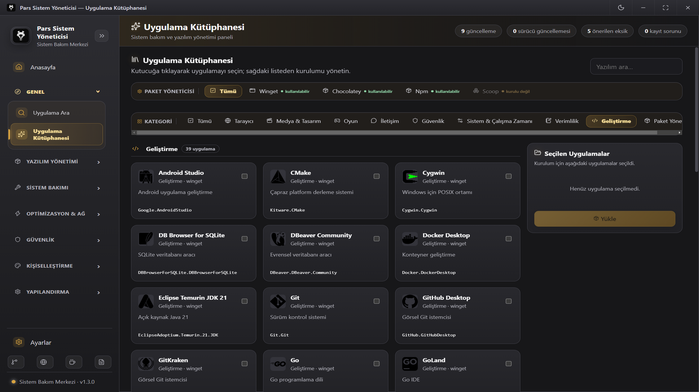

# Pars Sistem Yöneticisi 1.4.0

Kötü amaçlı yazılım sekmesi sekiz salt-okunur motorla genişletildi; İngilizce denetimi ana süreç, katalog ve bulgulara kadar yaydırıldı; uygulama ikonları renkli hâle getirildi ve self-update sonrası otomatik yeniden başlatma eklendi.

## Bu sürümde

- **Sekiz salt-okunur güvenlik motoru:** `signatures`, `heuristics`, `scripts`, `integrity`, `persistence`, `defender`, `hosts` ve `browser`. Her motorun ilerlemesi ve iptali ayrı izlenir; `scanned` alanı gerçek incelenen nesne sayısını gösterir.
- **Kullanılabilir bulgu raporu:** Arama, motor/ciddiyet filtreleri, metin ve JSON dışa aktarma eklendi. Bulgu başlıkları ve ayrıntıları İngilizce dil seçiminde çevrilir.
- **Tam İngilizce denetimi:** Ana süreç mesajları, doğrulama hataları, dışa aktarma başlıkları, güncelleyici iletişimi ve 480 anahtarlık uygulama kataloğu İngilizceye taşındı. Görünür Türkçe JSX metni ve çakışan/eksik çeviri anahtarı kalmadı.
- **Renkli uygulama ikonları:** Katalog kartlarında tek renkli logos yerine renkli favicon kullanılıyor; doğrudan renkli ikonlar korunuyor. Kurulu uygulama ikonu `DisplayIcon` üzerinden 500 uygulamaya kadar çıkarılıyor; arama, başlangıç, bloatware ve kalıntı pencerelerinde gerçek ikon gösteriliyor.
- **Güncelleme sonrası yeniden başlatma:** NSIS kurulumu `--force-run` ile tamamlandığında uygulamayı kendiliğinden açıyor; uygulama 1,5 saniye sonra kapanıyor. Portable modda otomatik yeniden başlatma yok, kurulum dosyası dosya gezgininde gösteriliyor.
- **Güvenlik modeli korundu:** Yönetici izni, açık onay, zorunlu yedek, salt-okunur tarama, timeout’lar ve dışlanan yollar değişmedi. `UserChoice`, COM/CLSID, servisler, SharedDLLs, yazı tipleri ve ODBC otomatik silinmez; Geri Dönüşüm Kutusu varsayılan kalır.
- **1.3.0’dan gelenler:** 249 uygulamalık katalog ve doğrulanmış ikonlar, vektör arayüz ikonları, gömülü winget kurulumu ve eski sürüm algılama akışı sürüyor. Uygulama verileri kaldırma sırasında silinmez.

## Ekran görüntüleri

Görseller 1.3.0 arayüzünden alınmıştır; 1.4.0 arayüzü aynı düzeni korur.

| Anasayfa | Kurulu Uygulamalar |
| --- | --- |
|  |  |
|  |  |
|  | |

## İndirme

- **Kurulum:** `Pars Sistem Yoneticisi Setup 1.4.0.exe` (NSIS, başlat menüsü + masaüstü kısayolu) — 85.463.266 bayt
  - SHA-256: `0ae405e012dc4ea790b24ff8d2ad5f0c2d4bb71e55f5ecee7b229e874cf1c378`
  - SHA-512: `f9abf7e3b51d2323a6c52dd4b855aa3541fa4ebe2406cf7332f6c28651c56ca372b4229832034f05b5a0ff8a8f08a26d8dc19b80817fd2cef5817fe7b591798b`
- **Portable:** `ParsSistemYoneticisi-Portable.exe` — 85.249.083 bayt
  - SHA-256: `b8b4e9f0cc00f6278d66be4cca0c9f4eed82db380e32bcc27dbc0419ab3a048a`

Windows 10 (1809+) / Windows 11 x64 gereklidir. Kurulum exe’si winget eksikse resmi kaynaktan kurar; portable sürümde winget “Gerekli bileşenler” panelinden kurulabilir. Chocolatey, npm ve Scoop taramaları yalnızca ilgili araç kuruluysa seçilebilir.
Uygulama yönetici izinleriyle çalışır; açılışta UAC onayı görünür.

> İmzasız dağıtım olduğu için SmartScreen uyarısı çıkabilir. İndirme sayfasındaki SHA-256
> özetleriyle dosya bütünlüğünü doğrulayabilirsiniz.
