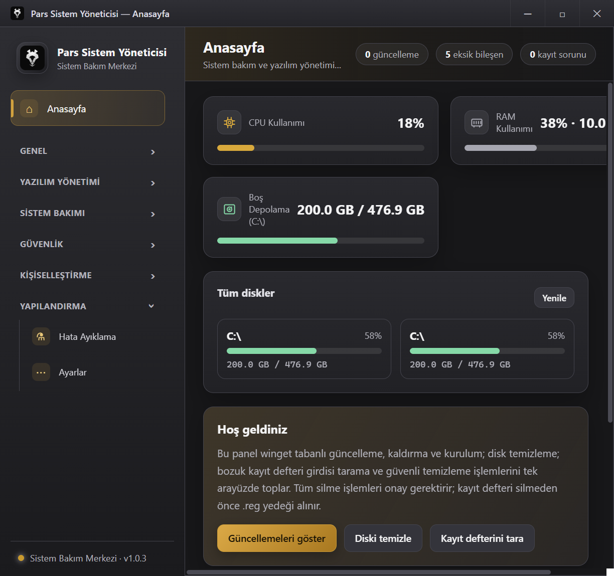
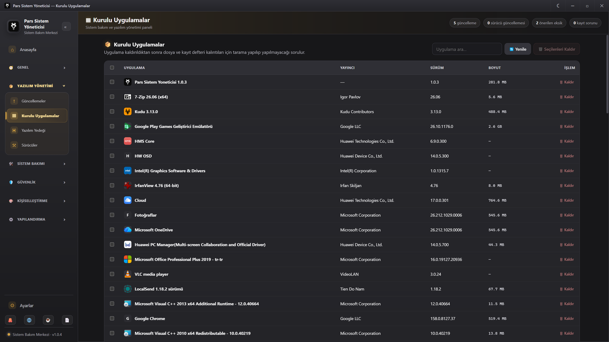
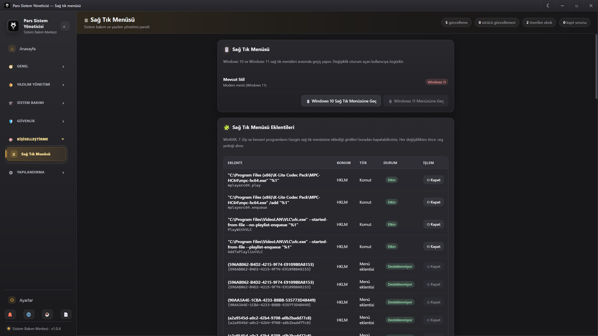

# Pars Sistem Yöneticisi 1.3.0

Uygulama kütüphanesindeki ikonlar yenilendi: 127 ikon eklendi, 7 bozuk favicon düzeltildi ve 249 girdinin tamamı doğrulandı.

## Bu sürümde

- **Uygulama ikonları tamamlandı:** 249 uygulamanın 35 mevcut ikonu denetlendi ve yanlış/bozuk olmadığı doğrulandı; 127 uygulamaya yeni ikon eklendi. Kütüphane kartlarındaki görsel karmaşası kalktı, eksik veya hatalı logo kalmadı.
- **Marka ikonları:** 155 uygulama için Simple Icons vektör logosu kullanılıyor. CDN sürümü `16.38.1` olarak sabitlendi; tüm URL’ler HTTP 200 döndürüyor ve geçerli `<svg>` içeriği doğrulandı.
- **Doğrudan ve yerel ikonlar:** Simple Icons’ta karşılığı olmayan 6 uygulama için doğrulanmış doğrudan ikon URL’si, 1 uygulama için yerel SVG kullanılıyor. Toplam **162 açık ikon** ve **87 çalışan favicon yedeği** var.
- **Bozuk favicon düzeltmeleri:** 7 uygulamanın çalışmayan favicon bağlantısı yenisiyle değiştirildi. PotPlayer’ın bağlantı sıfırlayan `potplayer.tv/favicon.ico` adresi, HTTP 200 doğrulanan DuckDuckGo ikon servisiyle değiştirildi.
- **Kapsamlı doğrulama:** 249 girdinin tamamı tarandı; geçersiz marka slug’ı **0**, bozuk doğrudan ikon **0**, bozuk favicon **0**. İkonlar `currentColor` ile tema rengini izliyor ve favicon yedeği yalnızca logosu olmayan uygulamalarda devreye giriyor.
- **Arayüz ikonları korundu:** Lucide React eşlemesi ve merkezi `uiIcons.tsx` sözlüğü değişmedi; 203 Türkçe etiket, 115 farklı vektör ikon ve güvenli fallback düzeni sürüyor.
- **Yeni ekran görüntüleri:** Anasayfa, Güncellemeler, Kurulu Uygulamalar, Uygulama Kütüphanesi ve Sağ tık menüsü görselleri 1.3.0 arayüzünden yeniden alındı. README, tanıtım sitesi, Wiki ve bu release notu aynı dosyaları kullanıyor.
- **1.2.0’dan gelenler:** Katalog 249 uygulamaya çıkarıldı; arayüz ikonları vektörleştirildi. Kurucu `winget.exe` eksikse gömülü betikle Microsoft.WinGet.Client üzerinden resmi kaynaktan sessizce kurulum yapıyor; `/S --updated` sırasında ek pencere çıkmıyor. winget kurulamazsa uygulama kurulumu tamamlanıyor ve “Gerekli bileşenler” panelinden yeniden denenebiliyor.
- **Güvenlik modeli korundu:** Yönetici izni, açık onay, zorunlu yedek, salt-okunur tarama varsayılanı ve korumalı kayıt/klasör kuralları değişmedi. `UserChoice`, COM/CLSID, servisler, SharedDLLs, yazı tipleri ve ODBC otomatik silinmez. Eski sürüm algılanıp kaldırılır, uygulama verileri silinmez (`deleteAppDataOnUninstall: false`). Kurumsal sessiz mod varsayılan olarak kapalıdır.

## Ekran görüntüleri

Görseller 1.3.0 arayüzünden alınmıştır; kütüphane ekranı yenilenen ikonları ve 249 uygulamalık kataloğu gösterir.

| Anasayfa | Kurulu Uygulamalar |
| --- | --- |
|  |  |
|  |  |
|  | |

## İndirme

- **Kurulum:** `Pars Sistem Yoneticisi Setup 1.3.0.exe` (NSIS, başlat menüsü + masaüstü kısayolu) — 85.427.326 bayt
  - SHA-256: `55567ec3e35f5fb04cd0cb1a24c816a2f226a7e03334b49ea734428d295c4677`
  - SHA-512: `981238eaedecf08cecd451fa34c07338475ae9fda0e0346ee840a58c8646b84875c1ba8408d7da7cd23886c3612137d969c46977990ff464b5e8cf13de66bac5`
- **Portable:** `ParsSistemYoneticisi-Portable.exe` — 85.213.148 bayt
  - SHA-256: `3f25e54013bfd1d97bd6304027aaa14c25209e59f62f767c776db85ade160493`

Windows 10 (1809+) / Windows 11 x64 gereklidir. Kurulum exe’si winget eksikse resmi kaynaktan kurar; portable sürümde winget “Gerekli bileşenler” panelinden kurulabilir. Chocolatey, npm ve Scoop taramaları yalnızca ilgili araç kuruluysa seçilebilir.
Uygulama yönetici izinleriyle çalışır; açılışta UAC onayı görünür.

> İmzasız dağıtım olduğu için SmartScreen uyarısı çıkabilir. İndirme sayfasındaki SHA-256
> özetleriyle dosya bütünlüğünü doğrulayabilirsiniz.
