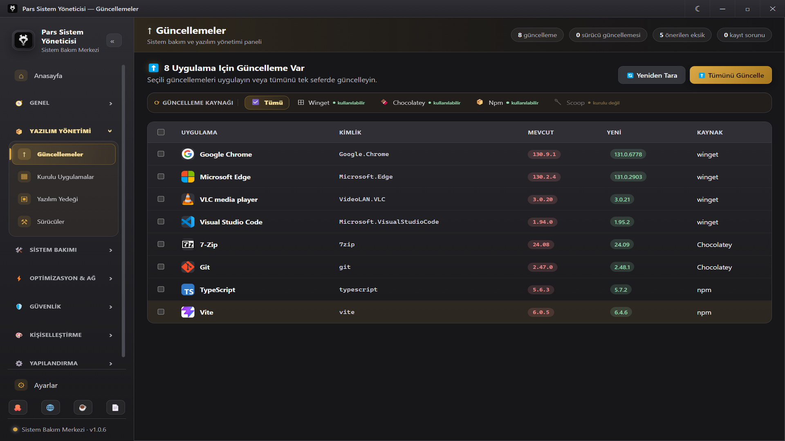

# Pars Sistem Yöneticisi 1.1.0

Kurulum exe’si winget’i denetliyor; eksikse Microsoft’un resmi kaynağından sessizce kurup doğruluyor. Görünür kurulumda ve `/S --updated` ile yapılan sessiz güncellemede aynı akış çalışır.

## Bu sürümde

- **Kurucuya winget kurulumu eklendi:** NSIS, dosyalar kopyalandıktan sonra `winget.exe` varlığını denetler. Eksikse pakete gömülü `install-winget.ps1` betiğini yönetici yetkisiyle, konsol penceresi açmadan çalıştırır; betik Microsoft.WinGet.Client modülüyle `Repair-WinGetPackageManager -AllUsers` uygular ve sonucu yeniden doğrular.
- **Sessiz güncellemeyle uyumlu:** `nsExec` kullanıldığı için `/S --updated` sırasında ek pencere veya onay kutusu çıkmaz. Kurucunun UAC onayı yeterlidir; kurumsal sessiz mod varsayılan olarak kapalıdır.
- **Hata toleransı:** winget kurulamazsa uygulamanın kurulumu yarım bırakılmaz; NSIS günlüğüne uyarı yazılır ve “Gerekli bileşenler” panelinden yeniden denenebilir. Betik artık tekrar çalıştırıldığında winget varsa doğrudan `OK` döner.
- **1.0.9’dan gelenler:** Alt bilgi dağıtımı düzeltildi, site/Blogger metinlerindeki eski sürüm kalıntıları temizlendi, `ci-release.js` sürüm belirteçlerini manifeste bakmadan güncelliyor ve etiket tek kaynaktan üretiliyor.
- **1.0.8’den gelenler:** Uygulama Kütüphanesi kartları kategori başlıklarıyla gruplanıyor; doğru NSIS anahtarları, eski istemci uyumu, kurulum hata bildirimi ve disk alanı kontrolü etkin.
- **Güvenlik modeli korundu:** Yönetici izni, açık onay, zorunlu yedek, salt-okunur tarama varsayılanı ve korumalı kayıt/klasör kuralları değişmedi. Eski sürüm algılanıp kaldırılır, uygulama verileri silinmez (`deleteAppDataOnUninstall: false`).

### 1.0.9’dan gelenler

Alt bilgi ve tüm sürüm etiketleri her dağıtım kanalında aynı sürümü gösteriyor; indirme bağlantıları doğrudan GitHub Releases adreslerini kullanıyor.

### 1.0.6’dan gelenler

Uygulama Kütüphanesi filtreleri dock görünümüne taşındı; Güncellemeler winget yanında Chocolatey, npm ve Scoop kaynaklarından da salt-okunur tarama yapabiliyor; kaynak bilincini koruyan güncelleme kuyruğu ve doğru winget listesi eklendi.

## Ekran görüntüleri

Tanıtım sitesi, README ve bu release notu aynı dosyaları kullanır. Görseller 1.0.6 arayüzünden alınmıştır; `screen-library.png` 1.0.8’de eklenen kategori başlıklarını göstermiyor, diğer ekranlar güncel görünümü yansıtır.

| Anasayfa | Kurulu Uygulamalar |
| --- | --- |
|  |  |
|  |  |
|  | |

## İndirme

- **Kurulum:** `Pars Sistem Yoneticisi Setup 1.1.0.exe` (NSIS, başlat menüsü + masaüstü kısayolu) — doğrulama özetleri workflow tamamlandıktan sonra eklenecek.
- **Portable:** `ParsSistemYoneticisi-Portable.exe`

Windows 10 (1809+) / Windows 11 x64 gereklidir. Kurulum exe’si winget eksikse resmi kaynaktan kurar; portable sürümde winget “Gerekli bileşenler” panelinden kurulabilir. Chocolatey, npm ve Scoop taramaları yalnızca ilgili araç kuruluysa seçilebilir.
Uygulama yönetici izinleriyle çalışır; açılışta UAC onayı görünür.

> İmzasız dağıtım olduğu için SmartScreen uyarısı çıkabilir. İndirme sayfasındaki SHA-256
> özetleriyle dosya bütünlüğünü doğrulayabilirsiniz.
